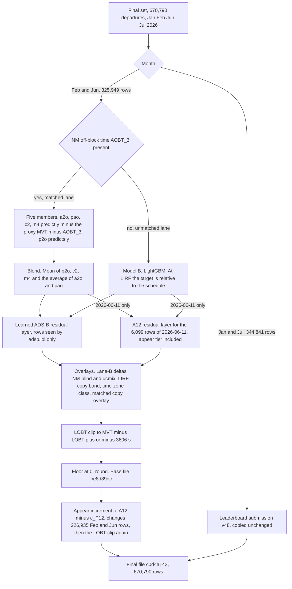

# PRC Data Challenge 2026: taxi-out time prediction (team resilient-hedgehog)

Code, notes and final prediction file of team **resilient-hedgehog** (MOCHITEC Inc.) for the
[PRC Data Challenge 2026](https://prc-data-challenge-2026.netlify.app/) of the EUROCONTROL Performance Review
Commission and the OpenSky Network. The task is to predict the taxi-out time of departures at 10 European airports.
The model splits departures by whether the Network Manager off-block time `AOBT_3` is known. Where it is, five
members (LightGBM, CatBoost, MLP) are blended; four of them predict the offset from the proxy `MVT − AOBT_3`. The
other rows get a separate model. A LightGBM trained on adsb.lol ADS-B tracks then corrects the rows that adsb.lol
covers, and rules derived from 2025 data handle label artefacts at LIRF and clip each prediction to a window around
`MVT − LOBT`. The January/July rows of the final file are the team's best leaderboard submission (v48); the
February/June rows come from a rebuild of that pipeline on the final data. The final file can be rebuilt byte for
byte from committed files with one script (§4).

## At a glance

| | |
|---|---|
| **Task** | predict `TAXITIME_SEC_mvt = MVT_TIME − BLOCK_TIME` (s) for departures at 10 airports; metric RMSE (§1) |
| **Final file** | `handoff/2026-10-13/final_v5_plus_febjun_appear.parquet`, added in commit `ea0e0a8`; md5 **`c0d4a1439862e68852b65f6854322a29`**; 670,790 rows; 2,151,179 bytes ([`docs/FINAL_SUBMISSION.md`](docs/FINAL_SUBMISSION.md) §1) |
| **Upload** | as `resilient-hedgehog_final.parquet`; bucket `last_modified` **2026-10-14T10:30:29Z**. The organisers' pages state the deadline as "2026-10-14T12:00 CET (2026-10-14T12:00+02:00)" and "2026-10-14T10:00Z"; the upload was 30 min 29 s after 10:00Z. Whether it is accepted is for the organisers (§3) |
| **Scorer** | result file written 2026-10-14T10:30:38Z: `"status": "Succeeded"`, `"used_pairs": 670790`. It contains no score ([copy](docs/final_phase_2026-10-11/final_result_2026-10-14.json)) |
| **Best public leaderboard score** | v48: RMSE **234.4099** on January + July 2026 (344,841 departures). The final file's January/July rows are v48's, unchanged. Board history: §8 and [`docs/DEVELOPMENT_HISTORY.md`](docs/DEVELOPMENT_HISTORY.md) §1 |
| **Leaderboard use** | besides model updates, the uploads include diagnostic probes, A/B checks and few-row rules; each upload is classed in [`docs/DEVELOPMENT_HISTORY.md`](docs/DEVELOPMENT_HISTORY.md) (§9) |
| **Reproduction** | byte for byte from committed intermediate files and the organisers' final-phase files (§4); what a full rebuild needs and what cannot be regenerated (§5) |
| **Licence** | GNU GPLv3 ([`LICENSE`](LICENSE)); external data and their licences in §7 |

## Contents

1. [Task and metric](#1-task-and-metric)
2. [Method overview](#2-method-overview)
3. [The final file](#3-the-final-file)
4. [Reproduce the final file](#4-reproduce-the-final-file)
5. [Full rebuild and its limits](#5-full-rebuild-and-its-limits)
6. [What is ours and what came from elsewhere](#6-what-is-ours-and-what-came-from-elsewhere)
7. [Data and licences](#7-data-and-licences)
8. [Results](#8-results)
9. [Development history and leaderboard use](#9-development-history-and-leaderboard-use)
10. [Repository map](#10-repository-map)
11. [Documentation map](#11-documentation-map)
12. [Licence and acknowledgements](#12-licence-and-acknowledgements)

## 1. Task and metric

- **Target.** `TAXITIME_SEC_mvt = MVT_TIME − BLOCK_TIME` (seconds) for departures at 10 airports: EDDF, EDDM, EGLL,
  EHAM, LEBL, LEMD, LFPG, LIRF, LSZH, LTFM.
- **Training data.** The organisers' 2025 movements (`training_2025-MM-01_*.parquet`, all 12 months), with
  the NM flight record joined (`AOBT_3_flt`, `LOBT_flt`, …).
- **Leaderboard set.** January and July 2026 (`ranking.parquet`, 344,841 departures).
- **Final set.** January, February, June and July 2026 (`final_ranking.parquet` / `final_submitting.parquet`,
  670,790 departures). The final file is `resilient-hedgehog_final.parquet`.
- **Metric.** RMSE over all rows.

## 2. Method overview

The diagram shows how the rows of the final file were produced. Every box is described in
[`docs/FINAL_SUBMISSION.md`](docs/FINAL_SUBMISSION.md) §2 (rows per month, §2.2 steps 1–5, §2.3 for 2026-06-11,
§2.5 for the appear increment). The model itself, with configs, features and formulas, is in
[`docs/METHOD.md`](docs/METHOD.md).



1. **Lanes.** About 98.5 % of rows have the NM off-block time `AOBT_3` (matched lane); in the final set 661,713
   rows are matched and 9,077 are not (`docs/SOLUTION_OVERVIEW.md` §1, `docs/FINAL_SUBMISSION.md` §2.2).
2. **Members and blend.** a2o (tuned LightGBM), pao (per-airport LightGBM), p2o (plain-target LightGBM), c2
   (CatBoost) and m4 (MLP); all but p2o predict `y − (MVT − AOBT_3)` (`src/prc/train.py`, `matched_target`). Blend:
   `((a2o + pao)/2 + p2o + c2 + m4) / 4`. Unmatched rows: model B, a LightGBM whose target at LIRF is
   `y − (MVT − SCHED)`.
3. **Learned ADS-B residual layer.** A LightGBM fitted on 2025 to the blend's residual, using ground-movement
   features from adsb.lol traces (push, first move, stand dwell, stops, positions) joined by callsign or by position.
   Clipped to ±1800 s; 0 at LTFM. 2026-06-11 uses the A12 layer, because the ingest of this layer had no adsb.lol
   data for that day.
4. **Overlays and LOBT clip.** Lane-B deltas (NM-blind, ucmix), LIRF rules fitted on 2025 rows (copy band, time-zone
   class, copy overlay), then a projection onto `[MVT − LOBT − 3606, MVT − LOBT + 3606]`, a window that holds on every
   matched 2025 row.
5. **Appear increment.** The appear tier describes where and when the aircraft is seen relative to its own stand.
   February/June get `c_A12 − c_P12` (`c_A12thin − c_P12` at EDDF) at the end; the LOBT clip is re-applied and a
   negative result keeps the old value.
6. **January/July = v48**, built from the same kinds of stages on the leaderboard set as a chain of per-submission
   delta files v33 → v48 that no single script builds. It carries the 12-month appear and EDDF coverage terms.

Details per step: `docs/METHOD.md` §2–§8. Validation: `docs/SOLUTION_OVERVIEW.md` §6; numbers: §8.

## 3. The final file

**The authoritative description is [`docs/FINAL_SUBMISSION.md`](docs/FINAL_SUBMISSION.md).** Its §1 defines the
file's identity: source commit, md5, rows and validation result. This section is a summary.

- **The file.** `handoff/2026-10-13/final_v5_plus_febjun_appear.parquet`, md5 **`c0d4a1439862e68852b65f6854322a29`**,
  2,151,179 bytes, 670,790 rows. It was added in **`ea0e0a8`** (branch `claude/beautiful-davinci-ehugk4`, contained
  in `main`), deleted in `9849a14` and restored byte for byte in `0d43558`; it is in the tree on `main`.
- **Its rows** (`docs/FINAL_SUBMISSION.md` §2):

  | rows | values | `FINAL_SUBMISSION.md` |
  |---|---|---|
  | Jan + Jul, 344,841 | v48 unchanged: `handoff/2026-10-08/C15_appear12_cov26eddf.parquet`, md5 `8ee6679f…`, public leaderboard 234.4099 | §2.1 |
  | Feb 144,158; Jun except 2026-06-11, 175,692 | the chain shown in §2 above, run on the final data, giving the base `be8d89dc…` (`handoff/2026-10-13/final_from_v48.parquet` as committed in `25f6246`, branch `claude/laughing-cray-vvwh0k`), plus the appear increment on 103,311 Feb and 123,624 Jun rows | §2.2, §2.5 |
  | Jun 2026-06-11, 6,099 | the same chain with the A12 layer instead of our rebuilt layer; no increment | §2.3 |

  Earlier versions of this README (before `1d12abb`) named the base `be8d89dc…` as the final file. It was not
  uploaded.
- **The upload.** Uploaded as `prc-2026-resilient-hedgehog/resilient-hedgehog_final.parquet` by `prc.submit --final`;
  the bucket object's `last_modified` is **2026-10-14 10:30:29Z** and its read-back md5 matched. The ledger lines
  (`"kind": "final"`) are at the end of `experiments/submissions.jsonl` (`8189b58`). It replaced an object of
  2026-10-09 (4,079,671 bytes, uploader unknown, whose scoring had failed).
- **Scorer.** The result file written at 10:30:38Z says `"status": "Succeeded"`, `"used_pairs": 670790`, and
  contains no score (copy: `docs/final_phase_2026-10-11/final_result_2026-10-14.json`).
- **Deadline.** The organisers' pages state "2026-10-14T12:00 CET (2026-10-14T12:00+02:00)" and "2026-10-14T10:00Z".
  The upload was at 10:30:29Z, after 10:00Z. Whether it is accepted is for the organisers.
- **Why this file** (`docs/FINAL_SUBMISSION.md` §4). On 2026-10-14 the Jan/Jul part of the laughing-cray v6 file
  scored 234.5741 on the leaderboard (v50), while v48 resubmitted unchanged scored 234.4099 (v51), exactly v48's
  score. So the Jan/Jul rows stay v48, and February/June get the appear increment so that they follow v48's recipe.
- **What is not in the file** (`docs/FINAL_SUBMISSION.md` §3): no "+1×δ" re-anchor of January/July, and none of
  the later candidates on the branches (the laughing-cray "v2" to "v7a" files, including v6 `7e53142e…`; the reweight
  and LTFM variants; the beautiful-davinci LIRF-gate variants).
- **Hand-off notes.** Several notes under `handoff/` name a "recommended" file. Those files were not submitted (§10;
  `docs/FINAL_SUBMISSION.md` §7).

## 4. Reproduce the final file

These steps rebuild the uploaded file byte for byte and validate it (runbook
`docs/final_phase_2026-10-11/RUNBOOK_final_submit.md` §2–§5; `docs/FINAL_SUBMISSION.md` §5.2). Run every command from
the repository root. What the assembler does not rebuild is in §5.

### 4.1 Environment

Measured with uv 0.11.32 and Python 3.11.17, 1 min 34 s (runbook §2); `pyproject.toml` requires Python ≥ 3.11, < 3.13.

```bash
git clone https://github.com/MOCHITEC/prc-data-challenge.git   # or --depth 1 (the packed history is 250 MB)
cd prc-data-challenge
uv venv -q .venv
uv pip install -q --python .venv/bin/python -e ".[dev]"
uv pip install -q --python .venv/bin/python -r requirements-lock.txt
.venv/bin/python -c "import prc, lightgbm, polars; print('env ok')"
.venv/bin/python -m pytest -q          # optional: full suite on synthetic data, about 5-9 min
```

The tests need no competition data (364 passed, 2 skipped after the file removal of 2026-10-14;
`docs/final_phase_2026-10-11/PUBLIC_RELEASE_CHECKLIST.md` §3.1, which also gives the 250 MB in §4). `make bootstrap`
runs the same steps and also downloads the competition data if the credentials are set; that download step needs
`OSN_COMPETITION_BUCKET=prc-2026-datasets` exported, otherwise it prints only "download failed".

### 4.2 Competition files

The raw competition files are not in this repository (§7). They come from the organisers' OpenSky Network MinIO (S3)
service. Credentials come from environment variables only (template: `.env.example`; `.env` is git-ignored):

| variable | meaning |
|---|---|
| `OSN_ACCESS_KEY` (or `OSN_ID`) | MinIO access key |
| `OSN_SECRET_KEY` (or `OSN_SECRET`) | MinIO secret key |
| `OSN_S3_ENDPOINT` | default `s3.opensky-network.org` |
| `OSN_COMPETITION_BUCKET` | `prc-2026-datasets` |
| `OSN_TEAM_BUCKET`, `PRC_TEAM_NAME` | only needed for submissions |

Export the credentials and `OSN_COMPETITION_BUCKET=prc-2026-datasets` first; never print the secrets.

```bash
export OSN_COMPETITION_BUCKET=prc-2026-datasets
# final-phase files only, read-only (runbook §3):
.venv/bin/python -c "from pathlib import Path; from prc.io_minio import download_files; \
  [print(p) for p in download_files(bucket='prc-2026-datasets', dest=Path('data/raw/final'))]"
```

- This writes `final_submitting.parquet`, `final_ranking.parquet` and `ranking.parquet` (132 MB) to `data/raw/final/`,
  the default directory of the assembler and the validator. Runbook §3 lists their md5 values of 2026-10-13.
- `download_all()` (`.venv/bin/python -c "from prc.io_minio import download_all; print(len(download_all()), 'files')"`,
  also `make download`) fetches every object of the bucket, including the 2025 training files, into `data/raw/`, not
  `data/raw/final/`. It raises `RuntimeError: OSN_COMPETITION_BUCKET is not set` if the variable is not exported.
  Only the full rebuild (§5) needs it.

### 4.3 Assemble and validate

```bash
.venv/bin/python scripts/final/assemble_final_v48.py --out outputs/final/final_v5_plus_febjun_appear.parquet \
  --febjun-appear handoff/2026-10-13/feb_jun_appear_increment_on_blend5.parquet \
  --reference handoff/2026-10-13/final_v5_plus_febjun_appear.parquet \
  --expect-md5 c0d4a1439862e68852b65f6854322a29
.venv/bin/python -m prc.validate_final outputs/final/final_v5_plus_febjun_appear.parquet \
  --template data/raw/final/final_submitting.parquet --ranking data/raw/final/final_ranking.parquet \
  --expect-md5 c0d4a1439862e68852b65f6854322a29
```

- **Assembler.** It reads four committed files and stops if any md5 differs: v48 (Jan/Jul), the own-layer chain
  output `handoff/2026-10-13/inputs/orig_chain_blend_adsb2_ovl.parquet` (Feb, Jun except 06-11), the A12 chain output
  `handoff/2026-10-13/inputs/blend_A12_ovl.parquet` (06-11) and the increment table. It picks the source per row,
  floors at 0, adds the increment, re-applies the LOBT clip from `final_ranking.parquet` and reverts negative results.
  Rerun on 2026-10-14, it wrote the same bytes as the committed and uploaded file. Without `--febjun-appear` it
  writes the base `be8d89dc…` (`25f6246`), and `--june-layer a12` gives `c7ffa31e…` (`558c736`), also byte for byte
  (`docs/FINAL_SUBMISSION.md` §5.2).
- **Validator.** It prints **PASS**. It fails on a schema, row-count or id mismatch with the template, on nulls,
  negatives or a constant vector, on a missing or extra month, and on a different md5 (docstring of
  `src/prc/validate_final.py`). For the final file it reports 66 rows above 10,800 s as a warning
  (`docs/FINAL_SUBMISSION.md` §1). Run on `handoff/2026-10-13/final_v5_plus_febjun_appear.parquet`, it checks the
  committed file itself.

## 5. Full rebuild and its limits

The assembler of §4.3 takes v48, the two chain files and the increment table as committed. Rebuilding further upstream
is possible for some stages and not for others (`docs/FINAL_SUBMISSION.md` §5.3 and §6):

| stage | how | what it needs beyond the repository | committed shortcut |
|---|---|---|---|
| members (Feb/Jun) | `.venv/bin/python -m prc.pipeline --config <member config> --skip-cv --raw-dir <final raw dir> --work-dir <final work dir>` with the five configs of `docs/METHOD.md` §3; the matched rows' `fl_*` / `seq_*` columns rebuilt on the 2025 + 2026 union (`analysis/local_audit_fix2026.py`; result committed as `handoff/2026-10-13/inputs/feat_rank_extra_union_final.parquet`) | the organisers' 2025 training files, and the final files under the names `ranking.parquet` / `submitting.parquet`; a fresh fit, because `src/prc` saves no LightGBM or CatBoost model. A refit will not give identical numbers; how close it comes was not measured | `handoff/2026-10-13/members/` |
| blend | `((a2o + pao)/2 + p2o + c2 + m4) / 4`; unmatched rows take model B | — | `handoff/2026-10-13/pre_adsb_base_blend5_final.parquet`, equal to the blend of the member files on all rows |
| ADS-B residual layer | `docs/final_2026-10-11/adsb_layer.py apply --base <blend> --out <out>` | the script's hard-coded paths mapped to the committed copies (`docs/FINAL_SUBMISSION.md` §5.3), and the final ranking file | models in `docs/final_2026-10-11/adsb_models/`, per-day features in `handoff/2026-10-13/adsb_store/` |
| overlays and LOBT clip | `docs/final_2026-10-11/apply_overlays.py --laneB --lobt-clip --copy-feat unfixed` | the organisers' 2025 `training_*.parquet` (`--raw-dir`) and the `prc.pipeline` feature cache (`--feat-dir`); neither is committed | `handoff/2026-10-13/inputs/orig_chain_blend_adsb2_ovl.parquet`, `handoff/2026-10-13/inputs/blend_A12_ovl.parquet` |
| appear increment table | `docs/appear_tier_2026-10-05/final_adsb.py … --increment` (commands in `docs/FINAL_SUBMISSION.md` §5.3) | only `final_ranking.parquet` from §4.2: recomputed on 2026-10-14 from committed files, equal values on all 227,019 rows | `handoff/2026-10-13/feb_jun_appear_increment_on_blend5.parquet` |
| ADS-B features from raw traces | `scripts/adsb_ingest_all.py`, `scripts/adsb_ingest_2025.py`, `scripts/adsb_learn_features.py` (`docs/external_data.md`) | the adsb.lol `globe_history` archives: 194.9 GB for the 57 Jan/Jul 2026 days downloaded (2.20–4.28 GB per day); 166.11 GB for Jan/Jul 2025. The residual models use all 12 months of 2025; no total size was measured | the per-day features above, `handoff/2026-10-11/adsb/` |

Limits (`docs/FINAL_SUBMISSION.md` §6):
- **January/July cannot be regenerated exactly.** They are copied from v48, the end of a chain of delta files.
  Running the documented chain on January/July differs from v48 by RMS 53.2 s (median 16 s); with the appear
  increment, 43.4 s (median 13 s).
- **The months follow the same recipe only approximately.** January/July carry v47's layer chain through v48;
  February/June carry the rebuilt layer, and the increment was computed on the pre-ADS-B blend and added to the
  finished file. 2026-06-11 has the A12 layer with only 78 appear rows. No leaderboard measurement covers
  February/June.
- **Absolute paths.** Several final-chain scripts hard-code the paths of the machines they ran on
  (`/home/user/pb-work`, `/home/user/prc-final`, scratch directories). `docs/FINAL_SUBMISSION.md` §5.3 maps them to
  the committed copies. The scripts were not edited.

## 6. What is ours and what came from elsewhere

The eligibility page asks for an original solution, not a re-use of existing code with a new data input and output.
From the team's notes (`R` = `docs/competitor_research_2026-09-21/results/`):

- **Code.** Competitor repositories were read for ideas; the notes that read them state that no code was copied
  (`R/public-code-deep-dive-2026-09-30.md`, `docs/research_2026-10-05_repos/known_updates.md`), and the brief for
  measuring competitor ideas says "Never copy competitor code (GPL); ideas only"
  (`docs/research_2026-10-05_measure/PROTOCOL.md`). For the ADS-B extraction, ingest, features, residual, positional
  join, appear tier and final-set layer: "All of this code was written for this repository" (`docs/external_data.md`).
  The vendored third-party code recorded in the release checklist is openpyxl and et_xmlfile (MIT, one research
  script; §12). The models use LightGBM, CatBoost and scikit-learn.
- **Process.** Most notes are pre-registrations committed before the run, followed by results (`docs/README.md`);
  changes were accepted by a pre-registered rule on the team's 2025 data (`docs/SOLUTION_OVERVIEW.md` §6). The
  numbers are in §8.

Where the idea of each component of the final file came from:

| component | source of the idea, per the notes |
|---|---|
| two lanes; anchored target `y − (MVT − AOBT_3)` | public README of `saurabhdxt-labs/prc-challenge` (team merry-quicksand per `docs/research_2026-10-05_repos/inventory.md`), in the prior-art note of 2026-09-10 (`git show 48bd4a2:docs/03_prior_art.md` §8, Japanese); `docs/competitor_research_2026-09-21/SUMMARY.md` §H |
| members p2o (plain target), c2 (CatBoost), pao (per-airport); lever L2; the retune | kind-mango's public repository, via `R/public-code-deep-dive-2026-09-30.md`; named as the source in `R/plainy-blend.md`, `R/catboost-blend.md`, `R/per-airport-member.md`, `R/feature-levers-L1-L4.md`, `R/optuna-retune.md` |
| member m4 (MLP) | no outside source named; reason given: a function class different from the tree members (`R/mlp-member.md` §0.1) |
| lever L6 (gate retention) | other teams' congestion ideas, measured on the team's data (`docs/research_2026-10-05_measure/congestion.md`, Japanese) |
| cmix (LIRF copy mixture) | outgoing-boat's two-stage copy mixture (`docs/research_2026-10-05_measure/copy_plan.md`) |
| NM-blind blend | "Source: merry-mushroom v5" (`docs/research_2026-10-06_nmblind/plan.md`) |
| ucmix | the team's error decomposition of its OOF predictions (`docs/research_2026-10-07_ucmix/plan.md`, "出所") |
| learned ADS-B residual | "The only outside fact used is …: one competitor shipped a learned ADS-B residual model. No competitor code was opened. The features, the model and the code are our own" (`R/adsb-learned-residual.md`) |
| appear tier | smart-jigsaw's public implementation, which takes the time an aircraft is first seen at its stand as off-block (`docs/research_2026-10-01/gap/HANDOFF_PROMPT.md` item 2, Japanese, "code for reference only, do not copy"); ours uses OSM stands and a 2026 ADS-B stand map as residual-model columns (`docs/appear_tier_2026-10-05/plan.md` §0) |
| EDDF coverage-matched thinning | the team's audit of the 2025 → 2026 receiver-coverage change (`docs/appear_tier_2026-10-05/plan_cov26.md` §0, `docs/adsb_audit_2026-10-07/README.md`) |
| fl_/seq_ consistency fix | the team's audit of the 2025 → 2026 shift (`docs/shift_2026-10-06/README.md`) |
| LIRF copy band, time-zone class | derived from 2025 LIRF rows (`docs/lirf_wrap_2026-10-06/README.md`), which also cites two public repositories reporting the related "one-day" class (not in the final file) |
| LOBT clip ±3606 s | javidmardanov's public LOBT window rule, measured on the team's data before use (`docs/competitor_research_2026-09-21/plans/P5-physics-lower-bound.md` §0); outgoing-boat uses the same window (`docs/research_2026-10-05_repos/inventory.md`) |

The table does not classify the feature groups, model B's schedule target at LIRF or the positional ADS-B join; their
notes are listed in §11.

## 7. Data and licences

External data are fetched from public endpoints without credentials. The full list, with URLs, licences, fetch
scripts and joins, is [`docs/external_data.md`](docs/external_data.md).

| source | licence | status |
|---|---|---|
| adsb.lol `globe_history` ADS-B traces | ODbL 1.0 | final chain |
| OpenStreetMap (`aeroway=parking_position`, `aeroway=runway`) | ODbL 1.0 | final chain |
| OurAirports `airports.csv`, `runways.csv` | public domain | final chain |
| Iowa Environmental Mesonet ASOS/METAR | public domain, attribution requested | final chain |
| IANA time-zone database (through polars) | public domain | final chain |
| research only: Open-Meteo (CC BY 4.0); EUROCONTROL OPDI, PRU taxi-out additional time and ansperformance files | see `docs/external_data.md` (EUROCONTROL: attribution, non-commercial, no modification without permission) | not in any submission or the final file |

The model uses:
- **adsb.lol** `globe_history`: "Contains data from adsb.lol (globe_history), made available under the Open Database
  License (ODbL) 1.0."
- **OpenStreetMap**: "© OpenStreetMap contributors, available under the Open Database License (ODbL) 1.0."
- **OurAirports**: public domain.
- **Iowa Environmental Mesonet** METAR: "Weather observations from the Iowa Environmental Mesonet (IEM) of Iowa State
  University."

Research only, not used in any submission or in the final file:
- **EUROCONTROL** OPDI v0.0.2 flight events and the PRU taxi-out additional time. Source: EUROCONTROL. Only aggregate
  results are kept in the tree. The per-row files derived from them were removed on 2026-10-14 under the EUROCONTROL
  terms (no modification without prior written permission); they remain in git history (`docs/external_data.md`).

The files under `handoff/**/adsb_store/`, `handoff/2026-10-11/adsb/`, `handoff/2026-10-13/june_adsb_for_adsb_layer/`
and the stand tables derived from OSM are derived databases of adsb.lol and OSM. They are made available under ODbL
1.0 (see `docs/external_data.md`).

**Data notice.** The repository contains no raw competition files. It does contain per-row files with fields
derived from the PRC Data Challenge 2026 dataset (EUROCONTROL PRC / OpenSky Network): mainly the per-departure ADS-B
feature and position files under `handoff/2026-10-13/` and `handoff/2026-10-11/adsb/learn/`, which carry times,
airport, runway and aircraft type of 2026 departures. No licence for that dataset had been published
at the time of release. If the organisers require these files to be removed, please contact the team
(details: `docs/final_phase_2026-10-11/PUBLIC_RELEASE_CHECKLIST.md` §3.2).

## 8. Results

Only numbers that are in committed documents appear here; each row names its source. ΔRMSE in seconds, negative
is better, with the 95 % bootstrap CI that each source states. These are 2025 offline measurements of one change
against the base of its day, so the rows **do not add up**. `docs/METHOD.md` §9 has the same table with the change
measured in each row and the members' results alone.

*pooled OOF*: 2025 out-of-fold predictions of the `jan`, `jul` and `forward` folds, 672,428 rows. *Jan+Jul ADS-B CV*:
Jan + Jul 2025, 344,419 rows, leave-days-out (5 folds), day-block bootstrap. `R = docs/competitor_research_2026-09-21/results/`,
`M = docs/research_2026-10-05_measure/`, `A = docs/appear_tier_2026-10-05/results.md`.

| stage | ΔRMSE [95 % CI] | data | source |
|---|---|---|---|
| member p2o (plain target) | −0.78 [−1.00, −0.60] | pooled OOF | `R/plainy-blend.md` |
| member c2 (CatBoost) | −1.75 [−2.08, −1.47] | pooled OOF | `R/catboost-blend.md` |
| lever L2 (forward NM windows) | −0.32 [−0.45, −0.20] | pooled OOF | `R/blend-l2.md` |
| member pao (per-airport) | −0.77 [−0.92, −0.64] | pooled OOF | `R/per-airport-member.md` |
| retune of the anchored member | −0.89 [−1.10, −0.72] | pooled OOF | `R/optuna-retune.md` |
| member m4 (MLP) | −0.75 [−0.93, −0.58] | pooled OOF | `R/mlp-member.md` |
| lever L6 (gate retention) | −0.76 [−0.95, −0.56] | `forward` fold, 328,009 rows | `M/l6_verdict.txt`, `M/l6_plan.md` |
| cmix (LIRF copy mixture in a2o) | −0.49 [−0.83, −0.15] | pooled OOF | `M/cmix_verdict.txt` |
| lane B: NM-blind (w 0.25) | whole frame −0.42 | pooled OOF | `docs/research_2026-10-06_nmblind/verdict.txt`, `plan.md` |
| lane B: ucmix (LIRF unmatched) | whole frame −1.60 [−2.95, −0.40] | pooled OOF | `docs/research_2026-10-07_ucmix/verdict.txt`, `plan.md` |
| learned ADS-B residual | −14.03 | Jan+Jul ADS-B CV | `R/adsb-learned-residual.md` §2 |
| learned ADS-B residual, refit | −13.11 | Jan+Jul ADS-B CV | `R/adsb-learned-residual.md` §14 |
| appear tier (4 months) | −1.858 [−2.542, −1.346] | Jan+Jul ADS-B CV | `A` §1 |
| appear tier (12 months, A12) | −0.804 [−0.924, −0.692] | 2025, 12 months | `A` §12 |
| appear tier on held-out Feb+Jun 2025 | −1.434 [−1.997, −1.056] | Feb, Jun 2025 held out | `A` §21 |
| EDDF coverage delta (in v48) | all rows −0.19 [−0.39, −0.02] | Jan+Jul 2025, held out | `A` §18 |
| LIRF matched copy overlay (0.4·q) | MSE gain 390 s² per row (Jan 15, Jul 375) | Jan+Jul 2025 | `docs/posjoin_2026-10-05/deeper_checks.md` |
| LIRF unmatched copy band | 34 of 34 such rows are schedule copies | 2025 | `docs/SOLUTION_OVERVIEW.md` §4 |
| LOBT clip ±3606 s | the window holds on every matched row (2.06 M) | 2025 | `docs/SOLUTION_OVERVIEW.md` §4 |

The best pre-ADS-B blend on 2026-10-07 had a pooled OOF RMSE of 269.69 (`docs/research_2026-10-07_ucmix/plan.md`).

**Offline gains carry over to the leaderboard unevenly** (`docs/SOLUTION_OVERVIEW.md` §6):
- consistency fixes: about 2× their CV estimate;
- model-level additions: about 1×;
- ADS-B residual add-ons: 10–35 %.

For example, the 12-month appear tier delivered about 9 % of its CV gain on the board
(`docs/appear_tier_2026-10-05/results.md` §17). The fl_/seq_ train/test consistency fix gained −1.36 s on the board
(`docs/SOLUTION_OVERVIEW.md` §5).

**Leaderboard history** (January + July 2026, 344,841 departures). The full table, with the class of every
submission (model update, A/B, diagnostic, few-row rule), is in
[`docs/DEVELOPMENT_HISTORY.md`](docs/DEVELOPMENT_HISTORY.md) §1.

| version | what changed | leaderboard RMSE |
|---|---|---|
| v1 | baseline | 345.3520 |
| v4 | two clocks, weather, linear trees | 305.0270 |
| v10 | model B reparameterised on the schedule at LIRF | 284.3584 |
| v17 | ADS-B pushback override (rule) | 272.1788 |
| v21 | learned ADS-B residual replaces the rule | 254.7657 |
| v33 | plain-target, CatBoost, L2, per-airport and retuned members | 250.9496 |
| v34 | positional ADS-B overlay on 430 unmatched rows (a few-row rule; see `docs/DEVELOPMENT_HISTORY.md` §2.2) | 246.7493 |
| v39 | appear tier | 239.5208 |
| v42 | C12 batch | 236.4369 |
| v47 | C15: per-member consistency fix, 3-seed L6 deltas, ucmix | 234.4831 |
| **v48** | C15 + 12-month appear + EDDF coverage delta: **the January/July rows of the final file** | **234.4099** |
| v50 | check on 2026-10-14: the Jan/Jul part of laughing-cray v6 (`handoff/2026-10-13/janjul_only_final_v6_all5.parquet`, `55a91f49…`) | 234.5741 |
| v51 | control on 2026-10-14: v48 resubmitted unchanged (`8ee6679f…`) | 234.4099 |

v51 (v48 unchanged) scored exactly v48's original 234.4099, so the board had not moved, and v6's Jan/Jul rows are
0.1642 worse than v48's (§3; `docs/FINAL_SUBMISSION.md` §4). The v50/v51 upload lines are in
`experiments/submissions.jsonl`; the scores were read from the leaderboard. The final file itself has no score in
the repository (§3).

## 9. Development history and leaderboard use

[`docs/DEVELOPMENT_HISTORY.md`](docs/DEVELOPMENT_HISTORY.md) lists, from `experiments/submissions.jsonl`, which
leaderboard submissions were model updates and which were diagnostics or A/B checks, and which rules were derived by
inspecting ranking-set rows. In short:
- **Counts** (its §1). Up to v49, the ledger has 50 uploads under 48 version numbers: 33 model updates, 12
  diagnostics (in the ledger's words: probe, isolation, decomposition, test or check), 3 A/B checks and 4 few-row
  rules; two uploads carry two classes. v50 and v51 (§3, §8) came after that count.
- **Ranking-set inspection** (its §2).
  - Rule C7r of v41 (the LIRF "one-day" class) set q values for named 2026 flights, and the v41 board score was used
    to infer the labels of three specific ranking rows. C7r was then dropped; the final chain does not apply it. The
    two LIRF classes the chain keeps take their rates from 2025 (§2.3).
  - The positional ADS-B rule of v34 was motivated by EHAM snow days in the ranking set; its weights were set on 2025
    rows, and it is still in the chain as the `RULE` component of the ADS-B layer (§2.2; `docs/METHOD.md` §5).
  - Board scores were also read back into decisions: the lane and component isolation uploads (v9, v10, v13, v31,
    v43–v45), the v30 graft, the board-transfer ratios used in planning, and v49 (§2.4).
  - The "+1×δ" re-anchor and the LIRF copy-overlay gate came after the leaderboard closed; neither is in the final
    file (§2.6; `docs/FINAL_SUBMISSION.md` §3).
- **Dropped probes.** On 2026-10-11 two planned leaderboard probes were dropped because of the organisers' sentence
  "We will monitor submissions for attempts to learn from or exploit the ranking process" (its introduction).
- **Process facts** (its §3): two version collisions, an unrecorded 2026-10-09 final upload, and the choices that
  the notes label "post hoc".

## 10. Repository map

```
src/prc/         package: features, training (train.py, cv.py, mlp.py), pipeline, weather, OSM, OPDI (research),
                 submission gate and upload (validate_final.py, submit.py, io_minio.py), leaderboard reader
configs/         experiment recipes (yaml); the id of each is pinned in tests/test_*_params.py
scripts/         ADS-B ingest and learned residual (adsb_*.py), OSM fetch, OPDI ingest, blend builders;
                 scripts/final/assemble_final_v48.py rebuilds the final file (§4.3)
analysis/        post-model layers and audits (local_*.py): posjoin, LIRF overlays, LOBT clip, lane-B deltas
docs/            research notes, one folder per topic and date; FINAL_SUBMISSION.md, METHOD.md,
                 SOLUTION_OVERVIEW.md, external_data.md, DEVELOPMENT_HISTORY.md, features_log.md
docs/final_2026-10-11/      final-set chain: adsb_layer.py, apply_overlays.py, assemble_step.py, member configs, logs
docs/appear_tier_2026-10-05/ appear tier, final_adsb.py
handoff/<date>/  dated working notes and files passed between parallel sessions: candidate files, deltas,
                 member predictions, ADS-B stores (see below)
experiments/     append-only logs: experiments.jsonl (CV records), submissions.jsonl (every upload), pipeline.jsonl
tests/           pytest suite on synthetic data (no competition data needed)
sql/             early Snowflake load and profiling scripts; not used by the final chain
refs/            leaderboard API snapshots
outputs/         two shell scripts of the final-phase member runs (outputs/ret_logs/); the assembler writes here
.claude/         CLAUDE.md, working rules for the coding-assistant sessions (in Japanese)
```

**About `handoff/`.** The `handoff/<date>/` folders are dated working notes that parallel sessions passed to each
other, mostly in Japanese, kept as written as the record (`docs/FINAL_SUBMISSION.md` §7).
- Several name a "recommended" file, such as `handoff/2026-10-13/README.md` (`d0ce32b6…`, later `7e53142e…`) and
  `handoff/2026-10-14/README.md` / `handoff/2026-10-13/CANDIDATES.md` (`b7e8298d…`). **Those files were not
  submitted.**
- The uploaded file itself is marked withdrawn in `handoff/2026-10-13/CANDIDATES.md` (06:20 UTC on 10-13); it was
  chosen on 10-14 all the same.
- Where a hand-off note and `docs/FINAL_SUBMISSION.md` disagree about the final file, `docs/FINAL_SUBMISSION.md` is
  right; the upload ledger `experiments/submissions.jsonl` and the bucket override both.
- The parts of `handoff/2026-10-13/README.md` that concern the final file are translated in
  `docs/FINAL_SUBMISSION.md` §2.2, §5.3 and §8.

## 11. Documentation map

| topic | document |
|---|---|
| **the final file: identity, recipe, reproduction, limits** | [`docs/FINAL_SUBMISSION.md`](docs/FINAL_SUBMISSION.md) |
| the model: lanes, members, ADS-B layer, appear tier, EDDF delta, overlays | [`docs/METHOD.md`](docs/METHOD.md) |
| index of `docs/` | [`docs/README.md`](docs/README.md) |
| pipeline map (state at v47) | [`docs/SOLUTION_OVERVIEW.md`](docs/SOLUTION_OVERVIEW.md) |
| leaderboard use, every submission, row-level rules | [`docs/DEVELOPMENT_HISTORY.md`](docs/DEVELOPMENT_HISTORY.md) |
| external data, licences, fetch scripts | [`docs/external_data.md`](docs/external_data.md) |
| upload runbook; release checklist; final-phase impact | [`RUNBOOK_final_submit.md`](docs/final_phase_2026-10-11/RUNBOOK_final_submit.md), [`PUBLIC_RELEASE_CHECKLIST.md`](docs/final_phase_2026-10-11/PUBLIC_RELEASE_CHECKLIST.md), [`IMPACT.md`](docs/final_phase_2026-10-11/IMPACT.md) |
| final-set chain scripts (ADS-B layer, overlays, assembly of later variants) | [`docs/final_2026-10-11/`](docs/final_2026-10-11/) ([`adsb_layer_README.md`](docs/final_2026-10-11/adsb_layer_README.md), [`overlays_README.md`](docs/final_2026-10-11/overlays_README.md)) |
| final-file assembly | [`scripts/final/assemble_final_v48.py`](scripts/final/assemble_final_v48.py) |
| members and levers: p2o, c2 (and its retune), L2, pao, retune of the anchored member, m4 | [`plainy-blend.md`](docs/competitor_research_2026-09-21/results/plainy-blend.md), [`catboost-blend.md`](docs/competitor_research_2026-09-21/results/catboost-blend.md), [`catboost-retune.md`](docs/competitor_research_2026-09-21/results/catboost-retune.md), [`blend-l2.md`](docs/competitor_research_2026-09-21/results/blend-l2.md), [`per-airport-member.md`](docs/competitor_research_2026-09-21/results/per-airport-member.md), [`optuna-retune.md`](docs/competitor_research_2026-09-21/results/optuna-retune.md), [`mlp-member.md`](docs/competitor_research_2026-09-21/results/mlp-member.md) |
| L6 gate retention, cmix | [`docs/research_2026-10-05_measure/`](docs/research_2026-10-05_measure/) (`l6_plan.md`, `l6_verdict.txt`, `cmix_verdict.txt`, `copy_plan.md`) |
| lane B: NM-blind, ucmix | [`docs/research_2026-10-06_nmblind/`](docs/research_2026-10-06_nmblind/), [`docs/research_2026-10-07_ucmix/`](docs/research_2026-10-07_ucmix/) |
| learned ADS-B residual | [`adsb-learned-residual.md`](docs/competitor_research_2026-09-21/results/adsb-learned-residual.md) |
| appear tier, 12-month refit, EDDF coverage delta | [`results.md`](docs/appear_tier_2026-10-05/results.md), [`COV26_EDDF.md`](handoff/2026-10-08/COV26_EDDF.md), [`ON_C15.md`](handoff/2026-10-08/ON_C15.md) |
| coverage-weighted training (rejected) | [`docs/covw_2026-10-08/README.md`](docs/covw_2026-10-08/README.md) |
| positional ADS-B join and the v35 overlays | [`docs/posjoin_2026-10-05/README.md`](docs/posjoin_2026-10-05/README.md), [`deeper_checks.md`](docs/posjoin_2026-10-05/deeper_checks.md) |
| LIRF label classes | [`docs/lirf_wrap_2026-10-06/README.md`](docs/lirf_wrap_2026-10-06/README.md) |
| train/test consistency audit; ADS-B coverage audit | [`docs/shift_2026-10-06/`](docs/shift_2026-10-06/), [`docs/adsb_audit_2026-10-07/README.md`](docs/adsb_audit_2026-10-07/README.md) |
| validation rule and protocol | [`14-validation-design.md`](docs/competitor_research_2026-09-21/results/14-validation-design.md), `docs/SOLUTION_OVERVIEW.md` §6 |
| ideas taken from other teams and how they were measured | [`public-code-deep-dive-2026-09-30.md`](docs/competitor_research_2026-09-21/results/public-code-deep-dive-2026-09-30.md), [`docs/research_2026-10-05_repos/`](docs/research_2026-10-05_repos/), [`docs/research_2026-10-05_measure/PROTOCOL.md`](docs/research_2026-10-05_measure/PROTOCOL.md) |

## 12. Licence and acknowledgements

- Code: GNU General Public License v3.0 ([`LICENSE`](LICENSE)).
- Vendored third-party code: `docs/research_2026-10-05_aobt/kpi/pylib/` holds openpyxl 3.1.5 and et_xmlfile 2.0.0.
  Both are MIT; their licence files are next to them. They are used by one research script only.
- Data: see §7 and `docs/external_data.md`.
- The challenge and its data are provided by the EUROCONTROL Performance Review Commission and the OpenSky Network.
  The ADS-B, map, airport and weather data used by the model come from adsb.lol, OpenStreetMap contributors,
  OurAirports and the Iowa Environmental Mesonet; their attribution lines are in §7.
